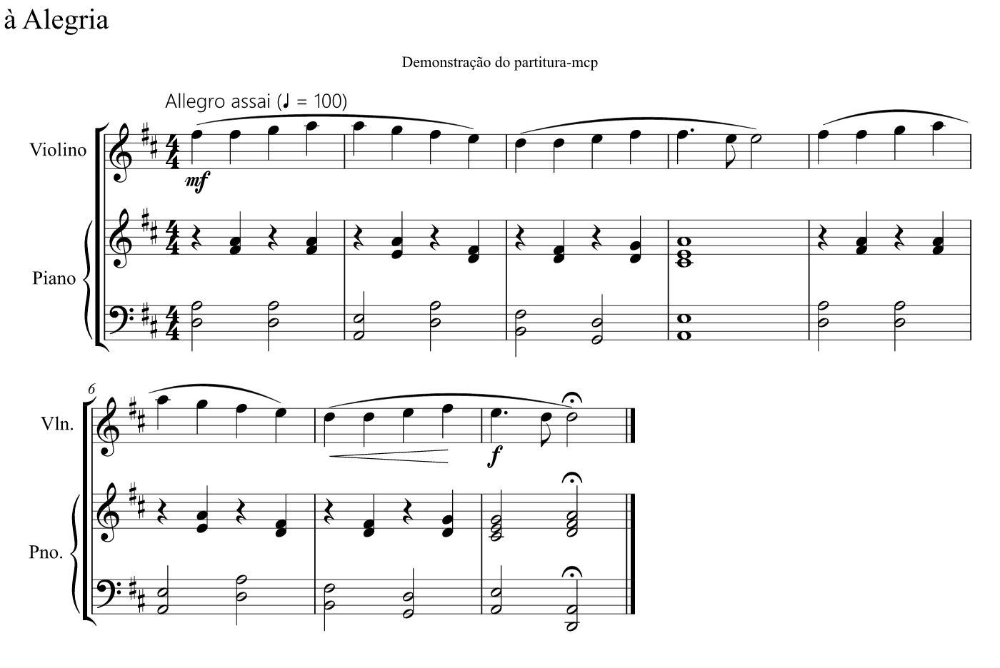

# MusicCraftAI — partitura-mcp



Servidor MCP local para criar e editar partituras com uma IA (Claude, GPT…), com **renderização ao vivo no navegador** via [Verovio](https://www.verovio.org). Cada edição aparece na hora em `http://localhost:4700/`, e os compassos alterados piscam em laranja. Também toca a partitura (sintetizador próprio no navegador, funciona offline; clique num compasso para tocar a partir dele), tem desfazer/refazer e exportação para MusicXML, que abre no Sibelius, no MuseScore, no Finale e no Dorico.

```
Claude Code / Claude Desktop ──stdio──► bridge.ts ──HTTP──┐
GPT / outros clientes ─────────────── HTTP /mcp ──────────┤
                                                          ▼
                                   server.ts (daemon, porta 4700)
                                   • partitura em memória + data/current.json
                                   • Verovio -> SVG + MIDI
                                   • WebSocket ──► navegador (visualizador)
```

Existe um único processo servidor, então todos os clientes e o navegador veem a mesma partitura.

## Requisitos

Node.js 22.18 ou mais recente. O projeto roda TypeScript direto, sem etapa de build.

```bash
npm install
```

## Iniciar

O `bridge.ts`, que é o comando registrado no Claude, **sobe o servidor automaticamente** se ele não estiver rodando. Para iniciar manualmente:

```bash
npm start
```

Depois de editar o código-fonte, **reinicie o daemon**: encerre o processo `node … src/server.ts`, ou feche e abra o Claude, que sobe tudo de novo.

## Conectar clientes

**Claude Code** (já configurado no escopo de usuário):

```bash
claude mcp add --scope user partitura -- "C:/Program Files/nodejs/node.exe" --disable-warning=ExperimentalWarning "C:/Users/Hermes/projetos_dev/sibelius-mcp-server/src/bridge.ts"
```

**Claude Desktop**: a entrada `partitura` já está em `%APPDATA%\Claude\claude_desktop_config.json`. Reinicie o app para carregar.

**ChatGPT / GPT**: o endpoint é `http://localhost:4700/mcp` (Streamable HTTP, sem sessão).
- *ChatGPT (modo desenvolvedor, conectores)* exige uma URL pública HTTPS. Exponha a porta com um túnel e proteja com token:
  ```bash
  set PARTITURA_TOKEN=um-segredo-longo
  set PARTITURA_ALLOWED_HOSTS=seu-subdominio.trycloudflare.com
  npm start
  cloudflared tunnel --url http://localhost:4700
  ```
  Depois cadastre `https://<túnel>/mcp` no ChatGPT com o cabeçalho `Authorization: Bearer <token>`.
- *OpenAI Agents SDK / Responses API* rodando na sua máquina pode apontar direto para `http://localhost:4700/mcp`.

## Ferramentas

| Ferramenta | O que faz |
|---|---|
| `score_new` | Cria uma partitura num arquivo novo (título, partes/instrumentos, armadura, compasso, tempo) |
| `score_info` / `read_measures` | Lê o resumo ou o conteúdo em notação compacta |
| `write_measures` | Escreve notas numa voz de uma parte (o principal) |
| `insert_measures` / `delete_measures` / `clear_measures` | Estrutura de compassos |
| `set_measure_attributes` | Armadura, fórmula de compasso, tempo e barras a partir de um compasso |
| `add_part` / `remove_part` / `update_part` | Partes/instrumentos |
| `set_metadata` | Título, subtítulo, compositor, letrista |
| `transpose` | Transposição por intervalo (`M2`, `-m3`, `P8`…) |
| `undo` / `redo` | Histórico (até 200 passos) |
| `snapshot` | PNG da partitura, para a IA conferir o resultado |
| `export_score` | MusicXML, MEI, MIDI, SVG e **PDF** em páginas A4 (pasta `scores/`) |
| `list_files` / `open_file` / `close_file` / `rename_file` / `duplicate_file` | Arquivos e abas |
| `delete_file` / `list_trash` / `restore_file` | Exclusão para a lixeira (`data/lixeira`) e restauração |
| `set_lyrics` | Distribui o texto de uma estrofe nas notas (hífens = sílabas, `~` = elisão, `_` = melisma) |
| `set_chords` | Cifras por compasso e tempo: `"F C7/F@3 F@4 \| C6 C7 F/C C/Bb"` |
| `open_in_sibelius` | Abre no Sibelius (NotePerformer, diagramação, impressão) |
| `open_viewer` | Abre o visualizador |

## Páginas e PDF

- **📄 Páginas / 📜 Contínuo** alterna entre a rolagem contínua e a visualização em folhas A4, como impresso. A escala se ajusta ao número de pautas e os sistemas se distribuem na página.
- **PDF** baixa a partitura em páginas A4 (vetorial). O PDF é gerado pelo Chrome ou Edge instalado, em modo invisível. Também dá para usar Ctrl+P no modo páginas.

## Arquivos, abas e "arquivo ativo"

- Cada partitura é um arquivo `.json` em `scores/`, salvo automaticamente a cada edição. Cada arquivo tem o próprio desfazer.
- A **barra lateral** do visualizador lista os arquivos da pasta, com busca. Os `.musicxml`, `.xml` e `.mei` abrem **só para visualização**.
- Clicar num arquivo abre uma **aba** e o torna o **arquivo ativo**. O cabeçalho mostra "IA edita: <arquivo>".
- Sem dizer o nome, a IA edita o arquivo ativo. Para mirar outro, peça "altere o arquivo X": as ferramentas aceitam `file` e passam a deixar esse arquivo ativo. O botão ⧉ copia o nome do arquivo.
- "+ Nova" cria uma partitura em branco. ✎ renomeia (ou duplo clique na aba) e 🗑 exclui, mandando para a **Lixeira**, de onde dá para restaurar. `duplicate_file` cria uma cópia para testar versões.

## Notação compacta

```
C4/4  F#5/8.  Bb3/2  r/4  (C4 E4 G4)/2  C4/2~ C4/4  3:2{C5/8 D5 E5}
C4/8 D4 E4 F4            ← duração omitida repete a anterior
C4/4[stacc,mf,slur(]  …  G4/4[slur)]
C4/4[cresc(] … E4/4[cresc),f]
C4/4[lyr:A-] D4[lyr:le-] E4[lyr:gri] F4[lyr:a]
compassos separados por |
```

Outras estrofes: `lyr2:`, `lyr3:`… (ou use `set_lyrics`).

Articulações: `stacc acc ten marc stacciss`. Também há `ferm` (fermata), `grace` (apojatura), as dinâmicas `pppp`…`ffff sf sfz fp…` e o texto `txt:"dolce"`.

## Limitações atuais

- As notas ficam em som real (sem instrumentos transpositores) e não há mudança de clave no meio da peça.
- Não há anacruse nem importação de MusicXML externo (só exportação).
- O layout (quebras, espaçamento) é automático do Verovio. O acabamento fino é feito depois, no Sibelius, a partir do MusicXML.

## Testes

```bash
npm test
```

O teste sobe um daemon numa porta separada (4799), conecta um cliente MCP pela ponte stdio e exercita as ferramentas e o WebSocket.

## Ouvir com o NotePerformer / acabamento no Sibelius

O botão **Abrir no Sibelius** do visualizador, ou a ferramenta `open_in_sibelius`, exporta o arquivo ativo como MusicXML e o abre no Sibelius instalado. Lá ele toca com o NotePerformer e você faz a diagramação e a impressão. Caminho do executável: detectado automaticamente, ou pela variável `SIBELIUS_EXE`.

> Por que não tocar o NotePerformer direto no navegador? Fora de um programa de partitura, o plugin se recusa a iniciar. Quando funciona, a primeira coisa que ele registra é o programa que o carregou, o que indica uma verificação do processo hospedeiro. A licença de avaliação não restringe explicitamente em quais programas ele pode ser usado, mas proíbe modificá-lo ou fazer engenharia reversa (2d) e distribuir o som gerado (2a). Optamos por não contornar essa restrição técnica e usar o Sibelius.

O player do navegador usa um sintetizador próprio que respeita as dinâmicas escritas (*p*, *f*, crescendos, acentos).
